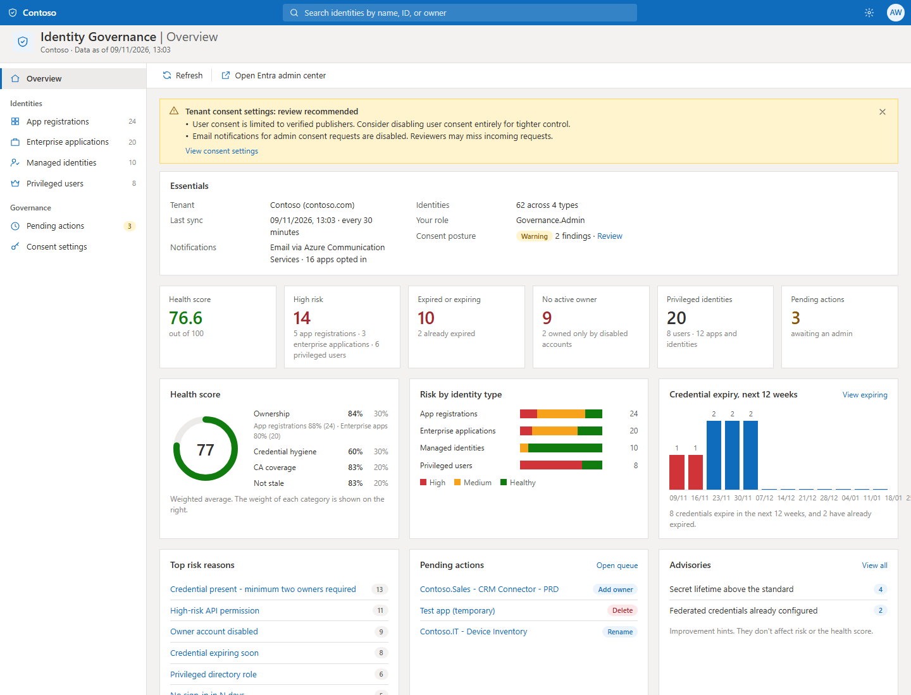
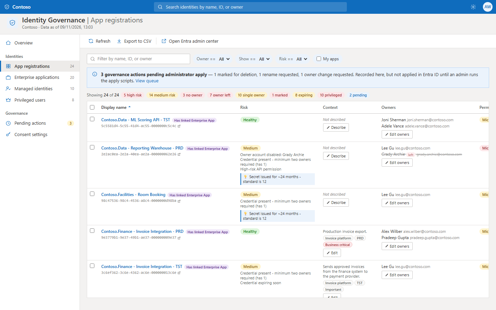
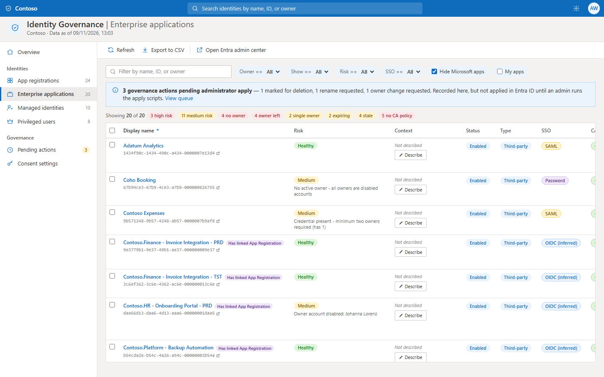
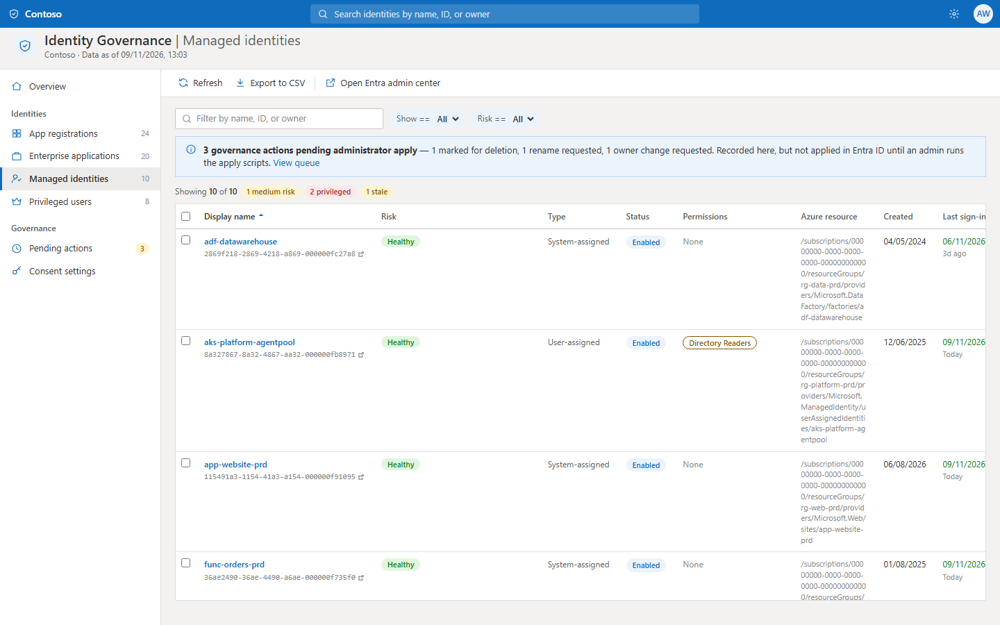
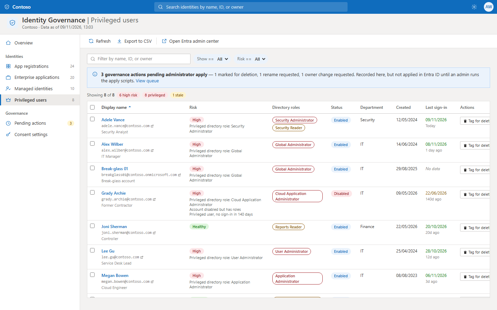
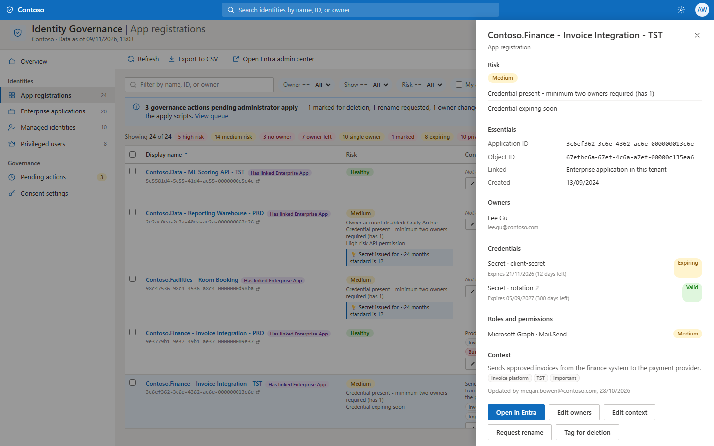
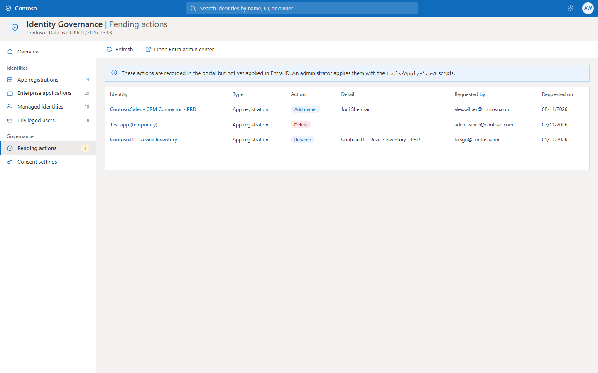
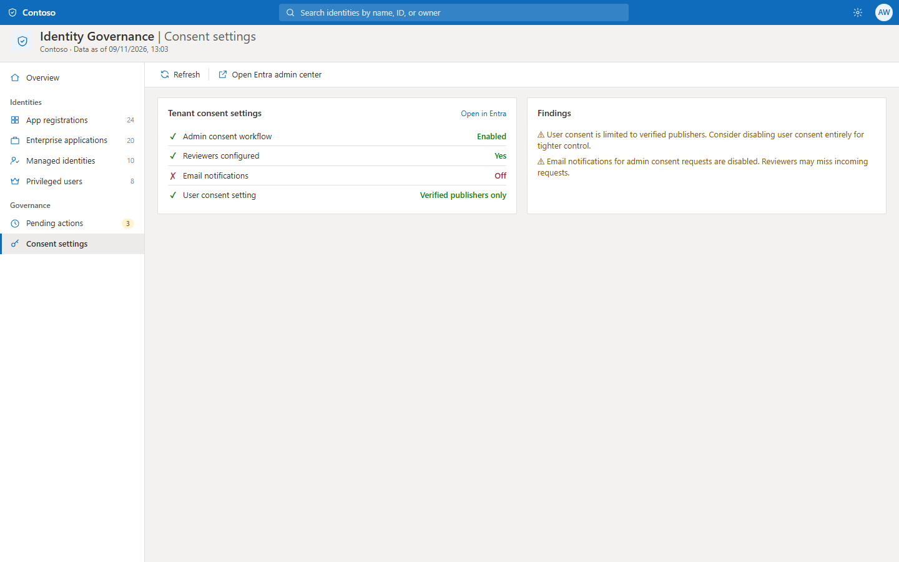
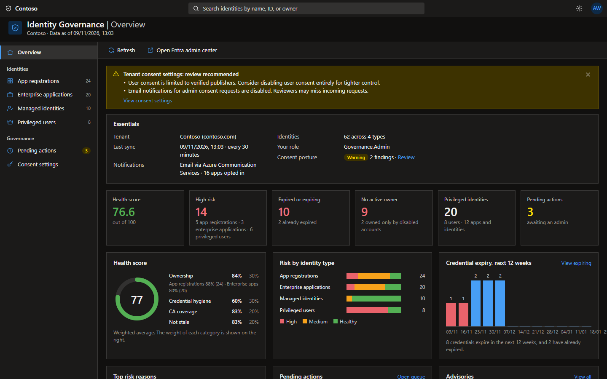

# Identity Governance Portal

A lightweight, self-hosted portal for governing the identities in your Microsoft Entra ID tenant — **App Registrations, Enterprise Applications, Managed Identities, and Privileged Users** — from a single pane, without standing up a full Identity Governance (IGA) suite.

It runs entirely inside your own Azure subscription, reads from Microsoft Graph with a managed identity (no app secrets for data access), and caches everything so the UI loads in seconds.

## What it does

- **One inventory, four identity types** — App Registrations, Enterprise Apps, Managed Identities, and Privileged (directory-role) Users, each with its own view.
- **Ownership tracking** — see who owns each app, flag the unowned, and raise owner-change requests. Owners whose accounts have been **disabled** are struck through and flagged: an app owned only by leavers is orphaned, whatever Entra still lists.
- **Risk surfacing** — expired/expiring credentials, high-risk API permissions, privileged directory roles, missing Conditional Access coverage, stale (no recent sign-in) identities, and single-owner apps holding credentials, rolled into a per-identity risk level.
- **Advisories** — separate from risk: apps that already have **workload identity federation** (so the secret may be removable) and secrets issued for longer than your standard. Advice, so it never inflates the risk counts.
- **Tenant health score** — four weighted governance categories (ownership 30%, credential hygiene 30%, CA coverage 20%, staleness 20%) summarised on a dashboard.
- **Consent posture** — user-consent and admin-consent-request settings at a glance.
- **Governance actions** — tag for deletion, request renames and owner changes, and opt into credential-expiry notifications that link straight to the renewal page.
- **A closed notification loop** — warnings at 30/14/7/1 days, escalation to a owner once a credential has actually expired, and a confirmation mail when it's renewed so owners know the loop closed.
- **Monthly owner digest** — one mail per owner covering only what needs attention. No attestation, no due dates, and no mail at all in a month where their apps are fine.
- **One switch for all of it** — the per-app notification toggle gates *every* mail the portal sends, digest included. Off means silent.
- **Owner-supplied context** — purpose, system, environment and criticality, filled in by the person who actually knows. Optional, never nags, and included in the export.
- **Self-service for owners** — non-admins can describe, rename, decommission and set notifications on the apps they own; every action is recorded intent an admin applies.
- **Export** — CSV of any filtered view.
- **Azure portal look** — an Overview dashboard, a left-hand menu and a details pane, with Azure light, Azure dark and High contrast themes. New themes are one CSS file plus one registry entry (see [docs/architecture.md](docs/architecture.md#themes)).
- **English or Danish** — one `language` deployment parameter sets the portal and all notification mails (see [docs/architecture.md](docs/architecture.md#languages)).

Data is precomputed by background timers and served from a cache, so the grid and dashboard render in seconds even on large tenants.

## Screenshots

All screenshots use made-up demo data.

| | |
|---|---|
| **Overview dashboard**  | **App registrations**  |
| **Enterprise applications**  | **Managed identities**  |
| **Privileged users**  | **Details pane**  |
| **Pending actions**  | **Consent settings**  |
| **Azure dark theme**  | |

### Try it locally

The portal runs against a demo API with made-up data, no Azure needed (Node 18+):

```bash
node Tools/demo/mock-server.js
```

Then open http://localhost:8080. `node Tools/demo/take-screenshots.js` regenerates the images above with headless Chrome or Edge.

## Who it's for

Organisations on Entra ID that want **lightweight, owner-centric governance** of their app and identity estate without the cost and complexity of a heavy IGA product:

- **IT and security teams at small-to-mid-sized organisations** who find Entra's native blades too fragmented for routine governance and review.
- **Managed service providers (MSPs)** running the same review process across multiple customer tenants (deploy one instance per tenant).
- **Teams preparing for audits** that need a quick, exportable picture of app ownership, credential hygiene, and privileged access.

It is intentionally **not** a replacement for Entra ID Governance / access reviews / PIM — it's a focused, low-cost complement for day-to-day app and identity hygiene.

## Running cost

Roughly **~$26–30 / month** for a single environment (West Europe pricing), dominated by one Basic App Service plan that hosts both apps:

| Item | Approx. monthly |
|---|---|
| Shared App Service plan — **B2 Linux** (both apps, always-on) | ~$26 |
| Storage account (Table, LRS, small data) | < $1 |
| Application Insights (sampled; billed to linked Log Analytics) | ~$0–few |
| Key Vault (optional, off by default) | negligible |

A single B2 costs about the same as two B1 plans but pools its capacity across both apps. See [docs/architecture.md](docs/architecture.md#cost) for the breakdown and trade-offs.

## Documentation

| Doc | What's in it |
|---|---|
| **[docs/setup-guide.md](docs/setup-guide.md)** | Step-by-step deployment — the checklist to get it running, including Front Door and secretless sign-in |
| **[docs/architecture.md](docs/architecture.md)** | Components, data flow, the cache/precompute model, hosting plan, and costs |
| **[docs/security.md](docs/security.md)** | Authentication, managed-identity permissions, RBAC, secrets, and network posture |
| **[Tools/README.md](Tools/README.md)** | Admin scripts that apply recorded governance actions (deletions, renames, owner changes) |

## Quick start

1. Copy a parameter file from `azResources/` to `azuredeploy.parameters.<env>.local.json` (git-ignored) and fill it in.
2. Deploy infrastructure + code with the Azure CLI: `./deploy.ps1 -ResourceGroupName <RG> -ParametersFile <file>`.
3. Grant the Function App's managed identity its Azure RBAC and Microsoft Graph permissions (`Setup/` scripts).
4. Create the Entra app registration that fronts sign-in, set `authClientId`, and redeploy to turn on authentication.

Full instructions: **[docs/setup-guide.md](docs/setup-guide.md)**.

## Repository layout

| Path | Contents |
|---|---|
| `azResources/` | `main.bicep` and example parameter files (placeholders only) |
| `deploy.ps1` | Deploys infrastructure and code with the Azure CLI |
| `Setup/` | One-off scripts for RBAC, Graph permissions, directory roles, mail and the sign-in app registration |
| `Tools/` | Admin scripts that apply recorded governance actions, test and favicon helpers, and the local demo (`Tools/demo/`) |
| `src/function-app/` | PowerShell Azure Functions: the API and the background timers |
| `src/web-app/` | The static portal (no build step) |
| `docs/` | Setup guide, architecture, security model and screenshots |
| `package.json` | `npm run demo` / `npm run screenshots` for the local demo (no dependencies) |

## How this was built

The architecture and design were provided by the maintainer. The implementation was developed with
[Claude Code](https://claude.com/claude-code), Anthropic's AI coding assistant, working to that
design. Much of the code, tests and documentation was written with AI assistance. The offline tests and the deploy gate (`deploy.ps1` runs them before
anything is deployed) apply to all of it. Review it as you would any third-party code before
running it in your tenant.

## Contributing, security, and license

- [CONTRIBUTING.md](CONTRIBUTING.md) — how to make and test changes.
- [SECURITY.md](SECURITY.md) — how to report a vulnerability, and what deployers are responsible for.
- Licensed under the [MIT License](LICENSE).
