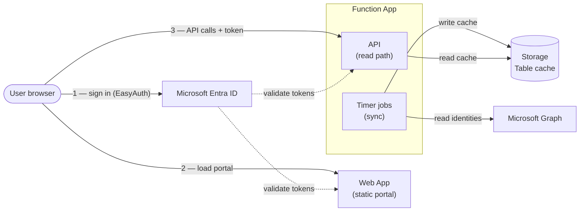

# Architecture

How the Identity Governance Portal is built and why. For deployment steps see [setup-guide.md](setup-guide.md); for the auth and permission model see [security.md](security.md).

## Diagram



The browser loads the static portal, then calls the API **directly** with a token from Entra — the portal does not proxy API traffic. Inside the Function App, **timer jobs** sync identities from Graph into the cache; the **API** only reads that cache. All outbound access (Graph, Storage, Communication Services) uses the Function App's managed identity. *(Application Insights telemetry is omitted for clarity.)*

## Components

| Component | Role |
|---|---|
| **Web App** (`*-portal-*`) | Static single-page portal (`src/web-app`: `index.html` plus `css/` and `js/`, no build step), served by Node on Linux. System-assigned managed identity. |
| **Function App** (`*-api-*`) | PowerShell 7.6 API + background timers on Linux. System-assigned managed identity. |
| **App Service plan** (shared) | One **B2 Linux** plan hosts *both* apps, with **Always On**. |
| **Storage Account** | Table storage — the identity cache plus governance state, requests, tenant config, and audit log. |
| **Application Insights** | Telemetry, linked to a central Log Analytics workspace (or a dedicated one). Local (key) auth can optionally be disabled so the Function App ingests via its managed identity (see [security.md](security.md#telemetry-ingestion-application-insights)). |
| **Key Vault** (optional, off by default) | Only for application secrets added by hand (`deployKeyVault`). The solution needs none: mail goes through Azure Communication Services and EasyAuth can use a federated credential, both with managed identities. |

Both apps reach Microsoft Graph and Storage **outbound** using their managed identities — no app secrets for data access. The only hand-managed credential is the EasyAuth client secret used for user sign-in, and even that can be replaced by a managed identity (`authUseManagedIdentity`, see [security.md](security.md#the-easyauth-client-secret)).

## Data flow

```
write path (every sync):   Microsoft Graph ──▶ timer jobs ──▶ Table cache
read path  (per request):  browser ──▶ API ──▶ Table cache ──▶ browser
```

1. **Background timers** pull from Graph on a schedule and write a fully-shaped cache to Table storage.
2. **Read endpoints** (`GetIdentities`, `GetTenantConfig`) serve that cache — they do almost no computation per request.
3. **The portal** renders the cache and applies live governance state on top.

This split is the core performance decision: the expensive work (Graph fetches, risk classification, shaping, aggregation) runs **once per sync in the background**, not on every page load.

### Tables

| Table | Contents |
|---|---|
| `IdentityCache` | One row per identity, partitioned by type (`appregistration`, `enterpriseapp`, `managedidentity`, `privilegeduser`). Each row stores a precomputed `ShapedJson` — the finished object the portal consumes. |
| `GovernanceState` | Portal-written state: deletion tags, rename requests, notify-on-expiry, and owner-supplied app context. Owned separately from the cache so syncs never overwrite it. |
| `AppOwnerRequests` | Pending owner add/remove requests. |
| `TenantConfig` | Consent posture (`consent/current`) and the precomputed dashboard summary (`dashboard/current`). |
| `NotificationLog` | Dedup records for expiry mail, escalations, renewal confirmations, and the monthly owner digest (`digest` partition), so nothing is re-sent. |
| `AuditLog` | Governance action history. |

### Precompute model

- **`ShapedJson`** — the sync timers parse owners/credentials/permissions, classify risk, and store the final per-identity object. `GetIdentities` deserialises it once and overlays only the live governance fields. This is what keeps the grid fast. Every governance field the read path writes must exist as a placeholder here — assigning an absent property to a deserialised object silently does nothing.
- **Risk vs advisories** — `RiskReasons` are defects and drive `RiskLevel` and the health score. `Advisories` are improvement hints (federation available, secret lifetime above standard) and deliberately affect neither; they are rendered apart in the Risk column so advice never inflates a risk count.
- **Dashboard summary** — the sync also aggregates the four health metrics into a single `dashboard/current` row, so the cards paint from one tiny read instead of waiting for every tab to load.
- **Live governance overlay** — deletion tags, rename requests, notify opt-ins, and pending owner requests change between syncs, so they're applied at read time from their own small tables (the cache stays a pure Graph mirror). Risk is scored entirely during sync — the read path does none.

### Timers

| Timer | Schedule | Writes |
|---|---|---|
| `SyncIdentityCache-Timer` | every 30 min | `IdentityCache` (apps/enterprise/MIs) + dashboard summary |
| `SyncPrivilegedUsers-Timer` | daily (05:00 UTC) | `IdentityCache` (privileged users) |
| `SyncTenantConfig-Timer` | daily (06:00 UTC) | `TenantConfig` consent row |
| `SendExpiryNotifications-Timer` | daily (08:00 UTC) | credential-expiry warnings, post-expiry escalation, and renewal confirmations (if mail via Azure Communication Services is configured) |
| `SendOwnerDigest-Timer` | monthly (1st, 07:00 UTC) | one summary mail per owner, only when something needs attention |

### One switch governs all mail

**`NotifyOnExpiry` on the identity is the single gate for every mail the portal sends** — warnings, post-expiry escalation, renewal confirmations, and the monthly digest alike. An identity with notifications off produces no mail of any kind, and never appears in anyone's digest. There is no separate digest subscription to discover or maintain: an owner who wants silence switches the toggle off, and a coordinator can see exactly who is covered from the toggle column.

The corollary is worth stating plainly: **an app with notifications off gets no escalation either**, even when its credential has expired and every owner has left. The portal's *"Notifications off (eligible)"* filter lists the apps in that state — apps that hold credentials and have an owner but no notifications — and is the right thing to sweep before a rollout.

### The notification loop

Within that gate, expiry mail is a closed loop rather than a one-way warning:

1. **Warn** at 30 / 14 / 7 / 1 days, to the app's *enabled* owners only — a disabled owner's mailbox is why expiries go unseen.
2. **Escalate** on the expiry day and again 7 days later, adding `governanceEscalationTo`. When every owner account is disabled, that address is the *only* recipient — otherwise an orphaned app expires in silence.
3. **Confirm** when the credential that was warned about disappears and a valid one has taken its place: the owner is told once that the loop closed, and the nagging stops.

Dedup rows in `NotificationLog` are keyed per credential (`t<days>-`, `x<days>-`, `renewed-` prefixes over the Entra `keyId`), so rotating a credential starts a fresh cycle rather than inheriting the old one's suppression.

On a fresh deploy the cache is empty until the first timer run; trigger them manually from the portal to populate immediately.

## Portal

The portal follows the Azure portal layout: a header with search and settings, a left-hand menu, a command bar, and a details pane that slides in from the right. Admins land on an **Overview** dashboard (essentials, health score, risk by type, credential expiry, top risk reasons, pending actions, advisories); members land on their own app registrations.

| Path | Contents |
|---|---|
| `index.html` | Page structure only |
| `favicon.svg` | App icon. `favicon.ico` and `apple-touch-icon.png` are generated from it by `Tools/New-Favicon.ps1` |
| `css/app.css` | Layout and components. Uses theme tokens only, never colour values |
| `css/themes/*.css` | One file per theme, each defining the same set of tokens |
| `js/themes.js` | Theme registry, applied before first paint |
| `js/i18n.js` | English and Danish texts, `t()` / `tn()` / `tv()` helpers |
| `js/core.js` | State, helpers, API calls and data loading |
| `js/table.js` | Identity list: columns, filters, sorting, selection, CSV export |
| `js/overview.js` | Overview dashboard, pending-actions queue, consent settings |
| `js/actions.js` | Governance actions and the details pane |
| `js/app.js` | Navigation, header menus and start-up |

### Themes

Azure light, Azure dark and High contrast ship by default. The first visit follows the device's light/dark setting; a choice made under **Settings (gear) → Appearance** is remembered per browser. To add a theme:

1. Copy `css/themes/azure-light.css` to `css/themes/<id>.css`, change the selector to `[data-theme="<id>"]`, and change the values. Keep every token name.
2. Add `{ id, label, href }` to the `THEMES` list in `js/themes.js`.

The Appearance menu is built from that list, so nothing else needs to change.

### Languages

English (default) and Danish ship. The language is set **per deployment** by the Bicep parameter `language` (`en` | `da`), not per user. It reaches both halves of the solution:

- **Function App** — the `LANGUAGE` app setting. `profile.ps1` loads `i18n/<code>.psd1` and exposes `T 'key' [args]` and `TN 'key' <count>` (picks `key.one` / `key.other`). Notification and digest e-mails, risk reasons, advisories and consent findings use it. Risk *levels* are decided on the underlying conditions, never on reason text, so a language change cannot move a level.
- **Portal** — `deploy.ps1` copies the setting into `config.json` as `language`; `init()` calls `setLanguage()` before first render. Static text in `index.html` is tagged with `data-i18n` (text), `data-i18n-html`, `data-i18n-ph`, `data-i18n-title` and `data-i18n-aria`; script text uses `t('key', {name: value})`. Data values the code compares on (risk level, credential status, context fields) stay English and are only *displayed* through `tv('prefix', value)`.

Risk reasons and advisories are stored in the cache, so after changing `language` they switch on the next `SyncIdentityCache-Timer` / `SyncPrivilegedUsers-Timer` run.

To add a text: add the key to both `src/function-app/i18n/en.psd1` and `da.psd1` (server) or to both blocks in `js/i18n.js` (portal). To add a language: copy the English file/block, translate every value, and add the code to the `@allowed` list of `language` in `main.bicep`, the `-in` checks in `profile.ps1` and `deploy.ps1`.

## Hosting plan

Both apps share **one B2 (Basic) Linux App Service plan with Always On** — not Consumption. Two design choices drive this:

- **Dedicated + Always On, not Consumption.** Consumption (Y1) scales to zero and a PowerShell worker pays a ~10-second cold start on the first request after idle. A Basic dedicated plan with Always On keeps the worker warm, so there is no cold start. The 64-bit worker and PowerShell 7.6 stack are set in `main.bicep`, along with parallel request handling (`FUNCTIONS_WORKER_PROCESS_COUNT` = 2, `PSWorkerInProcConcurrencyUpperBound` = 10) so the portal's start-up calls don't queue behind one another.
- **One shared plan, not two.** The portal is a near-idle static site, so giving it its own plan wastes a core. Pooling both apps on a single B2 (2 vCPU / 3.5 GB) lets the Function App's sync + parallel tab loads draw on the shared capacity when the portal is idle — better utilisation at roughly the same cost as two separate B1 plans. The read path is a thin cache read, so the portal contributes little contention; the heavy work lives in the background timers.

## Cost

Single environment, West Europe, approximate:

| Item | Monthly |
|---|---|
| Shared App Service plan — B2 Linux (both apps) | ~$26 |
| Storage (Table, LRS, small) | < $1 |
| Application Insights (sampled) | ~$0–few |
| Key Vault (optional, off by default) | negligible |
| **Total** | **~$26–30** |

A single B2 costs about the same as two B1 plans, but pools 2 vCPU / 3.5 GB across both apps instead of capping each at one core (see [Hosting plan](#hosting-plan)).

**Trade-offs:**
- **Two separate B1 plans** (~$26) give hard isolation between the apps, at the cost of wasting the near-idle portal's core — choose this only if you need strict isolation.
- **One shared B1** (~$13) is the cheapest, but both apps then fight over a single core.
- **B3** (~$52) doubles the headroom again — only worth it for very large tenants.
- **Back to Consumption (Y1)** would be near-free but reintroduces the ~10-second cold start; **Flex Consumption with an always-ready instance** avoids cold start while keeping pay-per-use economics.

The dominant cost is the one Basic plan; storage and telemetry are rounding errors at this scale.
